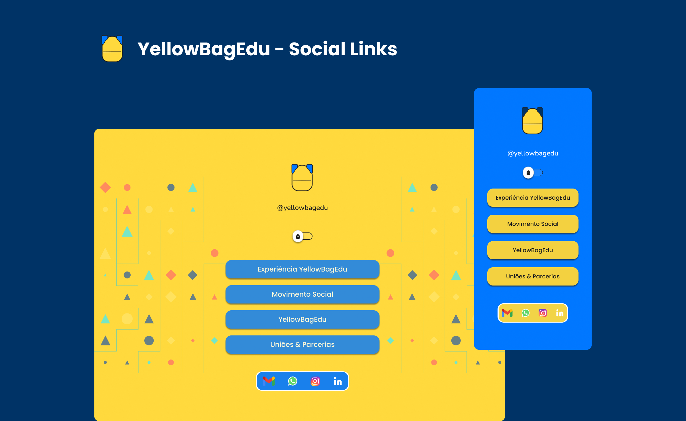

<h1 align="center" >YellowBagEdu | Bag Social Links</h1>

  

---

  <a href="#português">🇧🇷 Português</a> · <a href="#english">🇺🇸 English</a>

---

## 🇧🇷 Português

### 💡 Sobre o Projeto

O **Bag Social Links**, foi desenvolvido para a **YellowBagEdu**, uma startup paraense de educação 
criativa e tecnológica, reúne os principais canais da organização em um único espaço, facilitando 
o acesso às suas iniciativas, conteúdos e redes sociais.

A YellowBagEdu promove a aprendizagem, a criatividade e o desenvolvimento de soluções por meio da tecnologia.

### 🛠️ Tecnologias

  

### 💙 Desenvolvido pela equipe YellowBagEdu

### 👥 Autores

- Jornice Martins
- Marcelo Saldanha

---

## 🇺🇸 English

### 💡 About the Project

**Bag Social Links**, developed for **YellowBagEdu**, a startup from Pará, Brazil, focused on creative and technological education, brings the organization's main communication channels together in one place, providing easy access to its initiatives, content, and social media.

YellowBagEdu promotes learning, creativity, and the development of solutions through technology.

### 🛠️ Technologies

  

### 💙 Developed by the YellowBagEdu team

### 👥 Authors

- Jornice Martins
- Marcelo Saldanha
